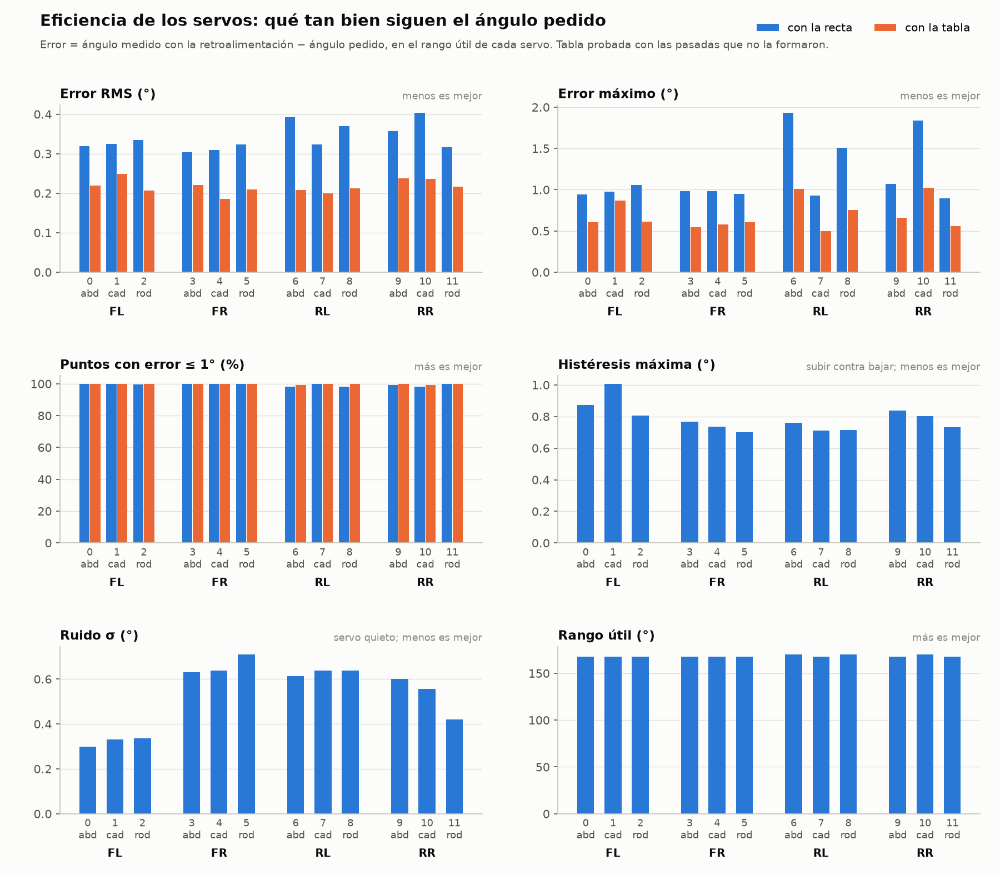

# 01 · Eficiencia de los 12 servos con retroalimentación

| | |
|---|---|
| Fecha | 29 de octubre de 2026 |
| Servos | 12 × FEETECH FS5115M-FB (Pololu), canales 0–11 |
| Fuente de servos | 5.99 V |
| Divisor de cada cable verde | 100 kΩ / 150 kΩ + 10 nF |
| Montaje | ☐ servos sueltos, solo con su horn ☐ en las patas (anotar) |
| Firmware | `firmware/esp32_principal` + `firmware/esp32_aux` (en la corrida: límite de 2450 µs) |
| Script | `pc/eficiencia_servos.py` (en la corrida: de 0° a 175°) |
| Datos | [`datos/2026-10-29_eficiencia_12_servos/`](../../datos/2026-10-29_eficiencia_12_servos/) |
| Duración | 28.2 min, sin fallas de comunicación (`DESC=0`) |

## Objetivo

Antes de medir la marcha hay que saber qué tan bien dice cada cable verde el ángulo de su
servo. La prueba contesta tres preguntas:

1. **Error:** ¿cuánto se aleja el ángulo medido del pedido?
2. **Repetibilidad:** ¿lee lo mismo llegando subiendo que bajando? ¿cuánto ruido tiene con el
   servo quieto?
3. **Rango útil:** ¿hasta qué ángulo sigue el comando?

## Método

- **Del ángulo al pulso:** u = 500 µs + θ · 11.11 µs/° (2000 µs para 180°).
- **Pasadas:** de 30 en 30°, de 20 en 20°, de 10 en 10°, de 5 en 5° y de 2 en 2°. Cada una
  sube de 0° a 175° y baja por los mismos ángulos.
- **Puntos:** 7 + 10 + 19 + 36 + 89 = 161 ángulos por sentido, o sea 322 puntos por servo y
  3 864 en total.
- **Cada punto:** 0.8 s de espera y 200 lecturas del ADC con 0.5 ms entre ellas. Se guarda la
  media, σ, mínimo y máximo.
- **Orden:** una pata a la vez; sus 3 servos se mueven juntos.

```
python pc/eficiencia_servos.py --port COM6 --voltaje 5.99
```

## Cálculos

| Métrica | Fórmula | Qué dice |
|---|---|---|
| Recta | θ̂ = a·V + b (mínimos cuadrados, puntos del rango útil) | Ángulo a partir del voltaje |
| Sensibilidad | S = 1 / \|a\| | mV del pin por grado |
| Error | e = θ̂ − θ pedido | Cuánto se equivoca cada punto |
| Error RMS | √(Σ e² / N) | El error típico |
| Histéresis | H = \|V↑ − V↓\| · \|a\| | Subir contra bajar, al mismo ángulo y en la misma pasada |
| Ruido | σθ = σV · \|a\| | La lectura con el servo quieto (mediana de los σ) |
| Rango útil | Desde el centro, mientras \|e\| ≤ 2° | Dónde el servo sigue el comando |
| Tabla de búsqueda | θ̂ = interpolación lineal de V en la pasada de 2° | Se prueba con las otras 4 pasadas |

### Ejemplo: canal 0 (FL abducción)

- **Recta:** a = −0.10018 °/mV, b = 186.87°, R² = 0.99996. Sensibilidad:
  S = 1 / 0.10018 = **9.98 mV/°**.
- **El punto de 120° (1833 µs):** subiendo da 668.4 mV y bajando 664.1 mV; promedio 666.2 mV.
  - θ̂ = −0.10018 × 666.2 + 186.87 = 120.13°, así que el error es **+0.13°**.
  - H = |668.4 − 664.1| × 0.10018 = **0.43°**.
- **Ruido:** σV = 2.98 mV, así que σθ = 2.98 × 0.10018 = **0.30°**. Con 200 lecturas por punto
  baja a 0.30° / √200 = 0.02°.
- **Resolución:** un paso del ADC (~0.8 mV) equivale a ~0.08°.

## Resultados



Todo en grados, salvo la sensibilidad.

| Servo | Rango útil | mV/° | RMS recta | RMS tabla | Máx tabla | Histéresis máx | Ruido σ |
|---|---|---|---|---|---|---|---|
| 0 · FL abducción | 0–168 | 9.98 | 0.32 | 0.22 | 0.61 | 0.87 | 0.30 |
| 1 · FL cadera | 0–168 | 9.93 | 0.33 | 0.25 | 0.87 | 1.01 | 0.33 |
| 2 · FL rodilla | 0–168 | 10.05 | 0.33 | 0.21 | 0.61 | 0.81 | 0.34 |
| 3 · FR abducción | 0–168 | 10.15 | 0.30 | 0.22 | 0.54 | 0.77 | 0.63 |
| 4 · FR cadera | 0–168 | 10.07 | 0.31 | 0.19 | 0.58 | 0.74 | 0.64 |
| 5 · FR rodilla | 0–168 | 10.14 | 0.32 | 0.21 | 0.60 | 0.70 | 0.71 |
| 6 · RL abducción | 0–170 | 10.01 | 0.39 | 0.21 | 1.01 | 0.76 | 0.61 |
| 7 · RL cadera | 0–168 | 10.10 | 0.32 | 0.20 | 0.50 | 0.71 | 0.64 |
| 8 · RL rodilla | 0–170 | 9.94 | 0.37 | 0.21 | 0.75 | 0.71 | 0.64 |
| 9 · RR abducción | 0–168 | 9.91 | 0.36 | 0.24 | 0.66 | 0.84 | 0.60 |
| 10 · RR cadera | 0–170 | 9.95 | 0.40 | 0.24 | 1.02 | 0.80 | 0.56 |
| 11 · RR rodilla | 0–168 | 10.09 | 0.32 | 0.22 | 0.56 | 0.73 | 0.42 |

En resumen:

- **Sensibilidad:** 9.9–10.2 mV/° en el pin, o sea ~16.7 mV/° en el cable.
- **Error con la recta:** RMS de 0.30–0.40°.
- **Error con la tabla:** RMS de 0.19–0.25°, máximo de 0.50–1.02°. Entre 99.3 y 100 % de los
  puntos quedan dentro de ±1°.
- **Histéresis:** 0.19–0.31° en promedio; la máxima de cada servo, 0.70–1.01°.
- **Ruido:** 0.30–0.34° en FL (ESP32 principal) y 0.42–0.71° en FR, RL y RR (ESP32 auxiliar).
- **Tamaño del paso:** la recta de una sola pasada se separa 0.07–0.29° de la recta con todos
  los datos.

## Observaciones

1. **Los 12 llegan a su tope en ~168° (2367 µs).** Hasta 168° el pin baja ~10 mV por grado.
   De ahí se queda fijo, entre 180 y 193 mV, aunque el pulso siga subiendo hasta 2444 µs.
   - **Lo que se detiene es el servo, no la lectura:** el mínimo que da el ADC es 142 mV, y la
     lectura se queda arriba de eso.
   - Los canales 6, 8 y 10 dan 170°, pero en ese punto ya se desvían 1.5–2°.
   - La medición con multímetro del 25 de octubre (263 mV en el cable a 2450 µs) se hizo solo
     en ese pulso, así que no mostraba dónde empezaba el tope.
2. **El error tiene la misma forma en los 12 servos:** es positivo cerca de 100° y negativo
   en los extremos, de hasta ±0.5°. Es una curvatura sistemática, del potenciómetro o del
   ADC, no ruido. Por eso la tabla de búsqueda baja el error de 0.35° a 0.2°.
3. **Los servos que lee la ESP32 auxiliar tienen el doble de ruido.** Lo más probable es la
   tierra o la alimentación de la auxiliar. En la calibración no pesa, porque cada punto
   promedia 200 lecturas (≤ 0.05°). En la marcha, con lecturas sueltas, sí.

## Cambios después de la prueba

- `US_MAX_CH` = 2360 µs (167.4°) en todos los canales del firmware de la principal.
- `eficiencia_servos.py`: el rango por defecto pasa a ser de 0° a 166°, y el límite a 2360 µs.

## Conclusiones

- Con la tabla de búsqueda, cada articulación se mide con ~0.2° de error típico y 1° como
  máximo.
- Los 12 servos son casi iguales entre sí: 10 mV/° y rango útil de 0 a 168°.
- Comparado con el 1501MG modificado: el FS5115M-FB tiene casi el doble de sensibilidad (contra
  5.7–5.9 mV/°) y menos error con la tabla (contra 0.33–0.36°). A cambio es más lento:
  300 °/s contra ~430 °/s.

## Pendiente

- [x] Comprobar con transportador el ángulo real: [prueba 02](02_angulo_real.md). El eje gira
      1.043 veces el ángulo de la convención; los grados de esta prueba son de la convención
      (`pc/escala.py` los pasa a grados reales).
- [ ] Mejorar la tierra de la ESP32 auxiliar y volver a medir el ruido: [prueba 03](03_ruido_auxiliar.md)
      (pospuesta el 2 nov 2026).
- [ ] Prueba de rampas, velocidad contra error: [prueba 04](04_rampas.md).
- [ ] Marcha en el aire con una pata, con video.
