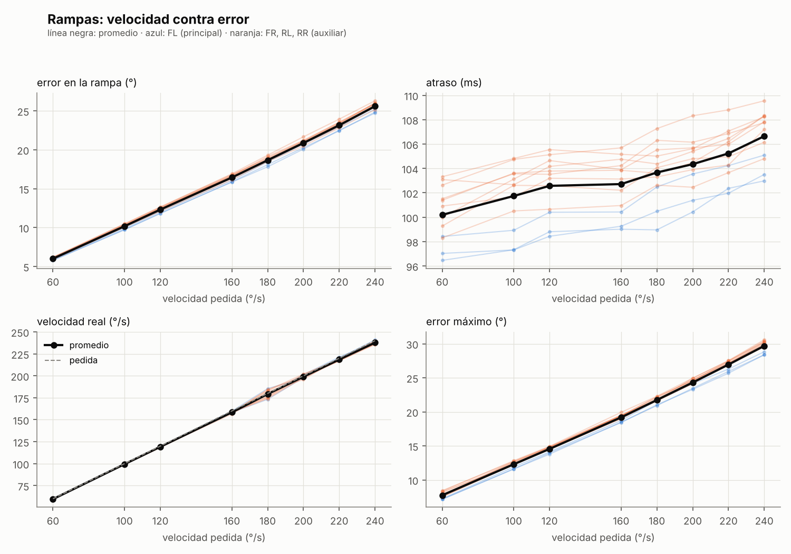

# 04 · Rampas: velocidad contra error

| | |
|---|---|
| Fecha | 2 de noviembre de 2026 (32.9 min, las 96 rampas completas) |
| Servos | Los 12 (canales 0–11), al aire, sin piezas; uno por uno |
| Fuente | 5.99 V (15 A) |
| Firmware | `firmware/esp32_principal` con el protocolo v2 (comando `G`) + `firmware/esp32_aux` (sin cambios) |
| Script | `pc/rampas.py` |
| Datos | [`datos/2026-11-02_rampas/`](../../datos/2026-11-02_rampas/) |
| Resultado | **Atraso de ~100 ms a todas las velocidades**: el error crece en proporción a la velocidad (6° a 60 °/s, 26° a 240 °/s). Sin saturación hasta 240 °/s |

## Por qué

Las pruebas 01 y 02 midieron al servo **quieto**: el cable verde da el ángulo con ~0.2° de error.
Para caminar, el servo sigue un ángulo que **cambia**. Esta prueba mide qué tan bien sigue una
rampa a velocidad constante según la velocidad:

- ¿Cuánto se atrasa respecto del pulso pedido?
- ¿Llega a la velocidad pedida o se satura?
- Al llegar, ¿se pasa? ¿Cuánto tarda en quedarse quieto?

Con eso se elige a qué velocidad puede ir cada articulación en la marcha y cuánto adelantar el
comando para compensar el atraso.

## Por qué la rampa la hace la ESP32

Si la compu mandara cada pulso, la hora de cada lectura la pondría Windows, con milisegundos de
incertidumbre: a 240 °/s, 5 ms de error en el tiempo son 1.2° de error falso. Por eso se agregó
el comando `G` al firmware de la principal (protocolo v2, ver `docs/hardware.md`):

- La ESP32 genera la rampa y actualiza el pulso cada 20 ms, que es lo más rápido que el servo ve.
- Graba el cable verde cada ~2 ms con su propio reloj.
- Al terminar le manda todo a la compu.

La auxiliar no cambió: ya manda sus 9 lecturas cada 2 ms. Los comandos de v1 tampoco cambiaron.

## Plan

| | |
|---|---|
| Velocidades | 60, 100, 120, 160, 180, 200, 220 y 240 °/s (grados reales, factor de la [prueba 02](02_angulo_real.md)) |
| Recorrido | De 30° a 150° reales (819 → 2097 µs), lejos de los dos topes |
| Cada servo | 0.5 s quieto · ida · 0.5 s quieto · vuelta · 0.5 s quieto; eso 3 veces |
| Orden | Velocidad por velocidad; dentro de cada una, los servos del 0 al 11, uno por uno |
| Entre servos | 1 s quieto en el inicio antes de su rampa; luego la ESP32 manda sus datos (4–10 s) |
| Duración | ~25 min |

**Por qué uno por uno:** cada FS5115M-FB puede pedir picos de más de 3 A al arrancar. Con un servo
a la vez, la fuente de 15 A sobra, y la caída de voltaje de un servo no afecta la medición de
otro.

**Por qué mandar los datos al terminar cada servo** (y no al terminar cada velocidad): la ESP32
solo guarda ~17.6 s de rampa, y la más lenta (60 °/s) dura 15.5 s. Además, si algo se corta, se
pierde un servo y no una velocidad completa. Los segundos que tarda en mandar los datos le sirven
al servo de descanso.

## Procedimiento

1. Carga los dos firmwares con Arduino IDE (placa "ESP32 Dev Module"): `esp32_aux.ino` en la
   auxiliar y `esp32_principal.ino` en la principal (COM6). En el Monitor Serie (115200), `?`
   debe responder `... DESC=0 PROTO=2`. Cierra el Monitor Serie.
2. Practica sin hardware:
   ```
   cd pc
   python rampas.py --simulado
   ```
3. Revisa los 12 ángulos con los servos sueltos (gíralos a mano; Ctrl+C sale):
   ```
   python rampas.py --port COM6 --revisar
   ```
4. Prueba corta, un servo de cada placa y dos velocidades (~1 min):
   ```
   python rampas.py --port COM6 --canal 0 7 --velocidades 60 240 --voltaje 5.99
   ```
5. La prueba completa:
   ```
   python rampas.py --port COM6 --voltaje 5.99
   ```
   Ctrl+C la detiene en cualquier momento: la rampa en curso se para, se sueltan los servos y se
   analiza lo que se alcanzó a medir.
6. Copia la carpeta de `pc/resultados_rampas/` a `datos/AAAA-MM-DD_rampas/` sin editarla, y pega
   aquí las tablas de su `resumen.md` y la gráfica `rampas.png`.

## Cálculos

Para cada ida y cada vuelta (luego se promedian las 3 vueltas):

| Métrica | Cómo | Qué dice |
|---|---|---|
| Ángulo pedido | El pulso que la ESP32 aplicó (cada 20 ms), en grados reales | Lo que se le pidió al servo |
| Ángulo medido | Cable verde → tabla de la prueba 01 → factor de la prueba 02 (`pc/escala.py`) | Dónde está de verdad |
| Error en la rampa | Promedio de pedido − medido en la segunda mitad de la rampa, en el sentido del movimiento | Cuánto va atrás a velocidad constante |
| Atraso | Error en la rampa / velocidad pedida | El mismo atraso, en ms |
| Velocidad real | Pendiente del ángulo medido en ese tramo | Si llega a la velocidad pedida |
| Error máximo | El mayor \|pedido − medido\| en toda la rampa y su espera | El peor caso |
| Sobrepaso | Cuánto pasa del valor final después de llegar | Si se pasa y regresa |
| Asentamiento | Desde que el pedido llega al final hasta que el medido queda a ±1° del valor final | Cuánto tarda en quedarse quieto |
| Error final | Valor final (últimos 100 ms de la espera) − pedido | Error con el servo quieto |

Para el sobrepaso y el asentamiento se usa una media móvil de 5 muestras (10 ms), para que el
ruido de una lectura suelta (~0.3° en FL y ~0.6° en la auxiliar) no cuente como movimiento.

**Qué incluye el atraso:** el pulso nuevo se escribe en el PCA9685 cada 20 ms, pero el servo lo
ve hasta el siguiente ciclo del PWM (hasta ~21 ms después). Ese tiempo también cuenta en el
atraso, porque en la marcha también va a pasar.

## Qué esperar

Si el servo se comporta como un control proporcional, el atraso en ms es casi el mismo a todas
las velocidades y el error en grados crece en proporción a la velocidad. Si a alguna velocidad la
velocidad real se queda abajo de la pedida, el servo se satura ahí. La hoja de datos dice 300 °/s
a 6 V, pero esa cifra no considera el factor de la prueba 02.

## Resultados



Promedio de los 12 servos; entre paréntesis, el servo más bajo y el más alto:

| Pedida (°/s) | Velocidad real (°/s) | Error en la rampa (°) | Atraso (ms) | Error máx (°) | Sobrepaso (°) | Asentamiento (ms) | Error final (°) |
|---|---|---|---|---|---|---|---|
| 60 | 60 (59–60) | 6.0 (5.8–6.2) | 100 (96–103) | 7.7 (7.1–8.4) | 0.76 (0.28–1.68) | 222 (91–464) | −0.83 (−1.36 a −0.39) |
| 100 | 99 (99–100) | 10.2 (9.7–10.5) | 102 (97–105) | 12.3 (11.6–12.8) | 0.73 (0.22–1.33) | 234 (128–426) | −0.51 (−0.63 a −0.26) |
| 120 | 119 (118–120) | 12.3 (11.8–12.7) | 103 (98–106) | 14.6 (13.8–14.9) | 0.49 (0.20–1.00) | 168 (132–253) | −0.35 (−0.62 a −0.19) |
| 160 | 158 (156–160) | 16.4 (15.8–16.9) | 103 (99–106) | 19.2 (18.4–19.9) | 0.52 (0.19–1.03) | 191 (155–310) | −0.35 (−0.60 a −0.17) |
| 180 | 179 (173–185) | 18.7 (17.8–19.3) | 104 (99–107) | 21.7 (20.9–22.3) | 0.73 (0.37–1.09) | 247 (170–358) | −0.24 (−0.49 a 0.01) |
| 200 | 199 (196–202) | 20.9 (20.1–21.7) | 104 (100–108) | 24.3 (23.3–24.9) | 0.83 (0.28–1.26) | 306 (173–450) | −0.21 (−0.37 a 0.15) |
| 220 | 219 (217–221) | 23.2 (22.4–23.9) | 105 (102–109) | 26.9 (25.7–27.5) | 1.11 (0.31–2.50) | 345 (166–485) | −0.27 (−0.50 a −0.03) |
| 240 | 238 (236–241) | 25.6 (24.7–26.3) | 107 (103–110) | 29.7 (28.4–30.6) | 1.51 (0.44–2.86) | 378 (197–488) | −0.26 (−0.56 a 0.02) |

Las tablas por servo están en `datos/2026-11-02_rampas/resumen.md` y las trazas en su carpeta
`trazas/`.

Otras cosas que se ven en los datos:

- **Los 12 servos se comportan casi igual.** Entre el más rápido y el más lento hay ~6 ms de
  atraso.
- **FL (principal) da 100 ms y los de la auxiliar 104 ms.** Probablemente no es el servo sino la
  medición. La hora de las lecturas de la auxiliar es la de cuando llegan a la principal, y el
  UART de la ESP32 entrega los bytes en bloques, no uno por uno, así que llegan unos ms tarde. No
  se ha comprobado.
- **Ida (30° → 150°) da 107 ms y vuelta (150° → 30°) 100 ms:** un poco de asimetría según el
  sentido.
- **El mayor sobrepaso** fue el del canal 8 (RL rodilla), de 3.8° a 220–240 °/s.
- **48 de 576 rampas (8 %) no se asentaron** dentro de los 0.5 s de espera, sobre todo a 60 °/s.
  No entran en el promedio del asentamiento, así que ese promedio sale algo optimista.
- **El asentamiento** se cuenta desde que el pedido llega al final, así que incluye los ~100 ms
  de atraso.

**Corrección del análisis.** La primera versión de `rampas.py` medía en el 60 % central de la
rampa. A 240 °/s la rampa dura 0.5 s, y en ese tramo todavía entra el arranque del servo (~0.1 s),
por eso daba una velocidad real de 225 °/s, como si se saturara. En la segunda mitad de la rampa
el servo sí va a 236–241 °/s. Ahora el análisis usa la segunda mitad, y la tabla de arriba es la
de esa versión (`python rampas.py --reanalizar`).

## Conclusiones

- **El FS5115M-FB va ~100 ms atrás del pulso que se le manda,** casi igual a todas las
  velocidades. Por eso el error en grados es la velocidad × 0.1 s: 6° a 60 °/s y 26° a 240 °/s.
  Se comporta como un sistema lineal, lo cual es bueno: el atraso es predecible.
- **El atraso incluye** hasta ~20 ms del refresco del PWM; el resto es del servo (el tiempo que
  tarda en reaccionar y en acelerar).
- **Sin carga llega a 240 °/s** sin saturarse. Con la pata y el peso del perro esto puede cambiar:
  hay que repetirla con carga.
- **Al llegar casi no se pasa** (0.5–1.5° en promedio) y se queda 0.2–0.8° antes del ángulo
  pedido. Es la banda muerta, del lado del que viene, igual que en la prueba 01.
- **Para la marcha:** si la trayectoria se manda tal cual, cada articulación va ~100 ms tarde.
  Hay dos opciones, que no se excluyen:
  1. Mandar el comando **adelantado ~100 ms**: θ(t + 0.1 s).
  2. **Corregir con la retroalimentación**, comparando el ángulo pedido de hace ~100 ms con el
     medido.

  La marcha en el aire con una pata (lo que sigue) es donde se prueba.

## Pendiente

- [ ] Repetir con la pata armada (con carga) cuando estén las piezas.
- [ ] (Opcional) Comprobar si los +4 ms de la auxiliar son del UART: hacer que la principal
      entregue los bytes de la auxiliar sin esperar a juntar un bloque.
- [ ] (Opcional) Esperas de 1 s en los extremos, para que todas las rampas alcancen a asentarse.
