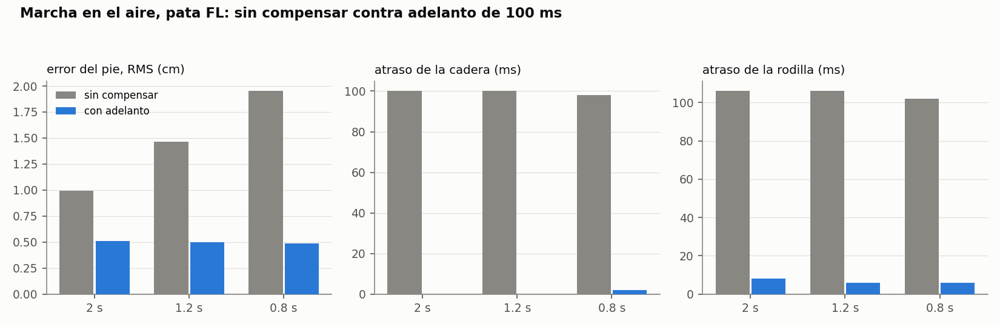
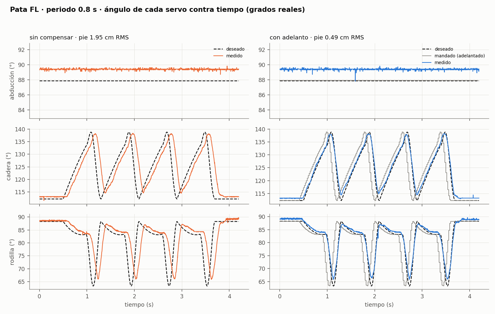
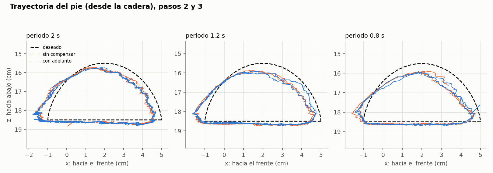

# 05 · Marcha en el aire con la pata FL

| | |
|---|---|
| Fecha | 3 de noviembre de 2026 (las 6 corridas completas) |
| Pata | FL armada (SpotMicro KDY0523, pie v2), canales 0, 1 y 2, colgando al aire |
| Fuente | 5.99 V |
| Firmware | `firmware/esp32_principal` con el protocolo v3 (comando `T`) + `firmware/esp32_aux` (sin cambios) |
| Medidas de la pata | [`datos/2026-11-03_pata_fl/pata_fl.json`](../../datos/2026-11-03_pata_fl/pata_fl.json) (las lee `pc/pata.py`) |
| Script | `pc/marcha.py` |
| Datos | [`datos/2026-11-03_marcha/`](../../datos/2026-11-03_marcha/) |
| Resultado | **Con el adelanto de 100 ms el error del pie baja de 1.0–2.0 cm a 0.5 cm a todas las velocidades**; lo que queda es un error fijo de ~0.5 cm, no de tiempo |

## Por qué

La [prueba 04](04_rampas.md) midió que cada servo va **~100 ms atrás** del pulso que se le manda.
Esta prueba lo lleva a un movimiento real: la pata FL da un paso en el aire. Contesta tres
preguntas:

1. ¿Qué tan lejos queda el pie de donde debía estar, si el paso se manda tal cual?
2. ¿Cuánto mejora si el comando se manda 100 ms adelantado?
3. ¿Cómo se ve el ángulo de cada servo contra el tiempo? Es la gráfica que pidió el profesor.

## La pata

Medido con la pata armada, los servos sueltos y `rampas.py --revisar --canal 0 1 2`:

| | Abducción (0) | Cadera (1) | Rodilla (2) |
|---|---|---|---|
| Límites (donde apenas choca) | 20° a 135° | 0° a 150° | 15° al tope del servo (174.6°) |
| Pata recta, derecho hacia abajo | 87.8° | 86.6° | 162.6° |
| Pose de pie (pie bajo la cadera) | 87.9° | 123.0° | 84.5° |
| Al subir el ángulo… | se mete hacia el cuerpo | va hacia atrás | se estira |

Medidas de eje a eje: muslo 11 cm, espinilla 13 cm, hombro 5.5 cm. La rodilla la mueve el servo
directo, sin varilla.

**Convención de las articulaciones** (`pc/pata.py`). El 0 de cada articulación es la pata recta,
apuntando hacia abajo:

| Articulación | Signo + | Fórmula |
|---|---|---|
| q_abd | se abre hacia afuera | servo = 87.85 − q_abd |
| q_cad | el muslo va al frente | servo = 86.6 − q_cad |
| q_rod | se dobla | servo = 162.6 − q_rod |

El pie, en cm desde el eje de la cadera (x hacia el frente, z hacia abajo):

- rodilla = (11·sin q_cad, 11·cos q_cad)
- pie = rodilla + (13·sin(q_cad + q_rod), 13·cos(q_cad + q_rod))

**Comprobación:** en la pose de pie da q_cad = −36.4° y q_rod = 78.1°, y el pie sale 2.1 cm
adelante de la cadera y 18.6 cm abajo. Casi justo debajo de la cadera, que es como se puso la
pose. Si una medida o un sentido estuviera mal, saldría lejos.

**Límites del script:** los medidos menos 5°, y la rodilla sin pasar de recta (hasta 160.6°): el
servo puede doblarla ~12° al revés, pero para caminar no conviene. Abducción 25–130°, cadera
5–145°, rodilla 20–160.6°.

## Por qué hizo falta el comando `T`

`G` mueve un solo servo. Un paso necesita mover los 3 a la vez con el reloj de la placa, así que
el firmware pasó al protocolo v3 (`docs/hardware.md`):

- **`T`:** carga una trayectoria de los canales que se elijan (de 1 a 12), un punto cada 20 ms, la
  ejecuta y graba sus cables verdes cada ~2 ms.
- **`S`:** manda los 12 pulsos en una línea y regresa las 12 lecturas, para el control en tiempo
  real que venga después (el puente con Agmen).

Los dos sirven para los 12 servos, aunque esta prueba solo use 3.

## El paso

El pie, en el plano de la pata y con la abducción quieta en 0:

- **Apoyo (60 % del periodo):** en línea recta de x = 5 cm a x = −1 cm, a z = 18.5 cm. Es lo que
  haría el pie en el suelo mientras el cuerpo avanza.
- **Vuelo (40 %):** regresa al frente y sube 3 cm, con una cicloide, una curva que empieza y
  termina sin velocidad.

El paso es de 6 cm de largo y 3 cm de alto, con el centro en x = 2 cm y z = 18.5 cm (casi la pose
de pie). Con eso la cadera va de 112° a 139° y la rodilla de 63° a 88°, a más de 6° de los
límites del script.

| Periodo | Vel. máx. cadera | Vel. máx. rodilla | Corrida |
|---|---|---|---|
| 2.0 s | ~80 °/s | ~85 °/s | 9.0 s |
| 1.2 s | ~135 °/s | ~145 °/s | 5.8 s |
| 0.8 s | ~200 °/s | ~215 °/s | 4.2 s |

Las tres quedan debajo de los 240 °/s que se midieron en la prueba 04. Cada corrida tiene 0.5 s
quieto, 4 pasos y 0.5 s quieto. Cada periodo se corre dos veces:

- **sin compensar:** a cada instante se manda el ángulo que se quiere en ese instante;
- **con adelanto:** se manda el ángulo de 100 ms después. El servo llega tarde y por eso llega a
  tiempo.

## Procedimiento

1. Carga `esp32_principal.ino` nuevo (en el Monitor Serie, `?` debe decir `PROTO=3`). La
   auxiliar no cambia. Cierra el Monitor Serie.
2. Practica sin hardware:
   ```
   cd pc
   python pata.py
   python marcha.py --simulado
   ```
3. Revisa la pata con los servos sueltos. Al mover la pata con la mano, el script muestra los
   ángulos y dónde está el pie; con el pie bajo la cadera, x debe salir cerca de 0.
   ```
   python marcha.py --port COM6 --revisar
   ```
4. Prueba corta, solo 2 s por paso (dos corridas, ~30 s):
   ```
   python marcha.py --port COM6 --periodos 2.0 --voltaje 5.99
   ```
5. La prueba completa (~3 min):
   ```
   python marcha.py --port COM6 --voltaje 5.99
   ```
   Antes de cada corrida la pata va despacio (40 °/s) a la pose de inicio, y al final regresa a
   la pose de pie y se suelta. Ctrl+C la detiene en cualquier momento.
6. Copia la carpeta de `pc/resultados_marcha/` a `datos/AAAA-MM-DD_marcha/` sin editarla. Si
   puedes, graba un video de la corrida de 0.8 s.

## Cálculos

En los 4 pasos, sin las esperas:

| Métrica | Cómo | Qué dice |
|---|---|---|
| Error de cada articulación | Medido − deseado, RMS y máximo (°) | Qué tan lejos va cada servo |
| Atraso de cada articulación | Cuánto hay que correr en el tiempo el deseado para que se parezca más al medido (de −100 a 250 ms) | Con adelanto debería quedar cerca de 0 |
| Error del pie | Distancia entre el pie medido (cinemática con los ángulos medidos) y el deseado, RMS y máximo (cm) | Lo que importa para caminar |
| Largo y alto hechos | Rango de x y de z del pie medido en cada paso | Si el servo "corta las esquinas" |

**Ojo al leer la gráfica del pie:** el atraso casi no cambia la *forma* del camino del pie, porque
el pie pasa por los mismos puntos, solo que tarde. Lo que cambia es *cuándo* pasa. Por eso el
error del pie se mide en el tiempo (dónde está contra dónde debía estar en ese instante) y no
comparando las formas. Con 4 patas, ese "cuándo" es lo que coordina que una pata se levante justo
cuando las otras tres sostienen el cuerpo.

## Qué esperar

- **Sin compensar:** atraso de ~100 ms en las dos articulaciones. El error del pie crece con la
  velocidad.
- **Con adelanto:** atraso cerca de 0 y error del pie mucho menor.
- **A 0.8 s** el servo empieza a "cortar las esquinas": el paso hecho queda un poco más corto y
  más bajo que el pedido.

En simulación (atraso de 100 ms metido a mano), el error del pie bajó de ~1–2 cm a ~0.1–0.2 cm con
el adelanto. Los números reales son los que cuentan.

## Resultados



| Periodo | Modo | Pie RMS (cm) | Pie máx (cm) | Largo hecho (cm) | Alto hecho (cm) | Cadera RMS (°) | Rodilla RMS (°) | Atraso cadera (ms) | Atraso rodilla (ms) |
|---|---|---|---|---|---|---|---|---|---|
| 2.0 s | sin compensar | 0.99 | 2.34 | 6.3 | 3.0 | 3.4 | 4.1 | 100 | 106 |
| 2.0 s | con adelanto | **0.51** | 0.83 | 6.3 | 3.0 | 1.1 | 1.0 | 0 | 8 |
| 1.2 s | sin compensar | 1.46 | 3.21 | 6.1 | 2.7 | 5.2 | 6.1 | 100 | 106 |
| 1.2 s | con adelanto | **0.50** | 0.98 | 6.2 | 2.7 | 1.2 | 1.2 | 0 | 6 |
| 0.8 s | sin compensar | 1.95 | 3.96 | 6.0 | 2.7 | 7.1 | 7.9 | 98 | 102 |
| 0.8 s | con adelanto | **0.49** | 0.89 | 6.0 | 2.7 | 1.4 | 1.5 | 2 | 6 |

Lo pedido: 6 cm de largo y 3 cm de alto. La abducción, que se quedó quieta, tuvo 1.5° de error en
todas las corridas.





### El error que queda con el adelanto es fijo

El error del pie se separó en dos partes: el promedio (sesgo) y lo que varía alrededor de él
(desviación estándar), en los 4 pasos. También se midió con la pata quieta, en los 0.4 s antes del
primer paso:

| Periodo | Modo | Sesgo del pie x, z (cm) | Lo que varía, x, z (cm) | Quieta antes de empezar, x, z (cm) |
|---|---|---|---|---|
| 2.0 s | sin compensar | −0.45, +0.15 | 0.71, 0.50 | −0.39, +0.29 |
| 2.0 s | con adelanto | −0.47, +0.16 | **0.09, 0.09** | −0.49, +0.28 |
| 1.2 s | sin compensar | −0.47, +0.17 | 1.14, 0.77 | −0.44, +0.23 |
| 1.2 s | con adelanto | −0.44, +0.15 | **0.11, 0.14** | −0.44, +0.23 |
| 0.8 s | sin compensar | −0.39, +0.17 | 1.61, 1.01 | −0.34, +0.13 |
| 0.8 s | con adelanto | −0.39, +0.14 | **0.17, 0.19** | −0.45, +0.24 |

- **Con el adelanto, lo que varía baja 8–10 veces** (de 0.7–1.6 cm a 0.1–0.2 cm). Eso es lo que
  corrige el adelanto: el *cuándo*.
- **Lo que queda (~0.45 cm hacia atrás y ~0.2 cm hacia abajo) es igual con la pata quieta**, así
  que no es de tiempo. En las articulaciones es un desfase de ~1.5° en la abducción, ~1° en la
  cadera y ~0.8° en la rodilla, siempre del mismo lado.
- Posibles causas, sin comprobar todavía: el peso de la pata contra cada servo (cuando lo cargan,
  no llegan exacto), la banda muerta (prueba 01: el servo se queda antes del ángulo, del lado del
  que viene) o el factor único de la prueba 02 (1.043) para servos que pueden variar ±2 %.

Otras cosas que se ven:

- **El atraso es el de la prueba 04 a todas las velocidades:** 98–100 ms en la cadera y 102–106 ms
  en la rodilla. La rodilla va ~6 ms más atrasada, así que con un solo adelanto de 100 ms le quedan
  6–8 ms.
- **A 1.2 y 0.8 s el vuelo sube 2.7 cm en lugar de 3**, con y sin adelanto. El adelanto corrige el
  tiempo pero no la amplitud. En la punta del vuelo, la rodilla se mueve más rápido de lo que el
  servo alcanza a seguir y "corta" el pico (en las gráficas, la rodilla no baja hasta 63°).
- **En la esquina de atrás del paso**, donde la cadera cambia de sentido de golpe, el pie se pasa
  ~0.7 cm hacia atrás. El paso tiene ahí un cambio brusco de velocidad (fin del apoyo).
- **0.8 s por paso funcionó** aunque la rodilla llega a 235 °/s, cerca de los 240 °/s de la
  prueba 04.

## Conclusiones

- **El modelo de la prueba 04 se cumple en un movimiento real de 3 servos a la vez:** cada
  articulación va ~100 ms atrás del comando, sin importar la velocidad.
- **Mandar el comando 100 ms adelantado funciona:** el error del pie baja de 1.0–2.0 cm a ~0.5 cm,
  y el atraso queda en 0–8 ms. Es una corrección sin costo: no necesita retroalimentación, solo
  calcular la trayectoria 100 ms antes.
- **Lo que queda es un error fijo de ~0.5 cm**, que no se arregla adelantando. Se puede atacar con
  la retroalimentación (comparar el ángulo medido con el pedido y corregir poco a poco) o con una
  calibración con carga. Hay que medirlo otra vez con la pata en el suelo, porque la carga cambia.
- **Para el aprendizaje por refuerzo:** el modelo del actuador que hay que meter en la simulación
  es ~100 ms de atraso (cadera ~100 ms, rodilla ~106 ms), ~1° de error fijo bajo carga y el pico
  del vuelo recortado a velocidades altas.

## Pendiente

- [ ] Video de la corrida de 0.8 s.
- [ ] Adelanto por articulación (cadera 100 ms, rodilla 106 ms) y ver si la rodilla baja de 6–8 ms.
- [ ] Hacer más suave el cambio de sentido al final del apoyo, para quitar el sobrepaso de la esquina de atrás.
- [ ] Repetirla con la pata en el suelo (con carga), cuando estén las 4 patas.
