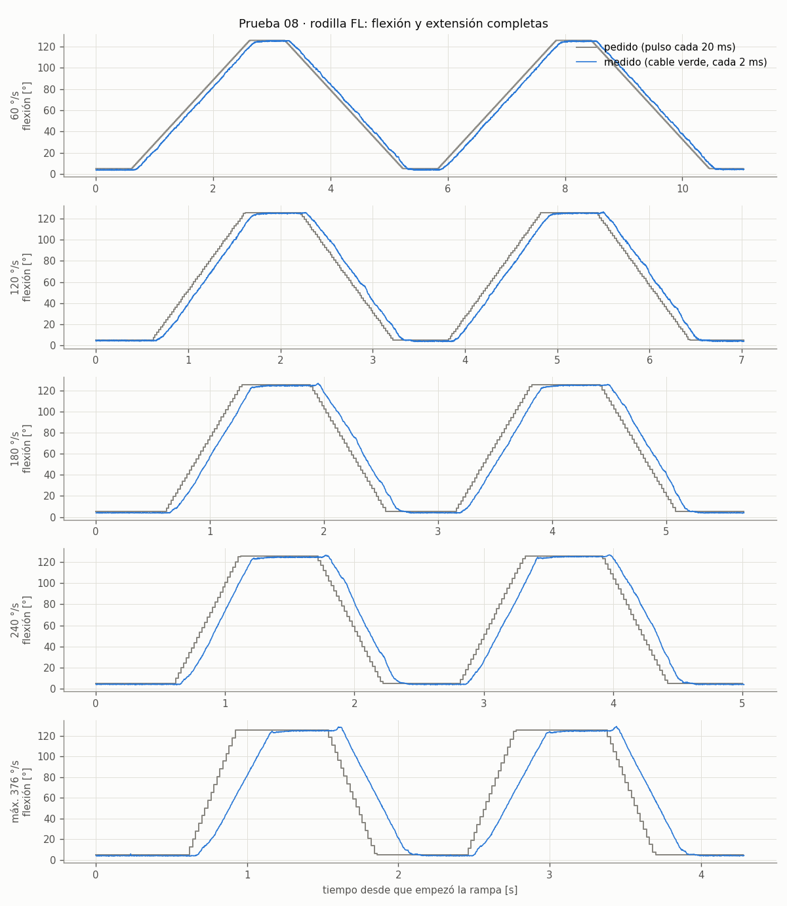
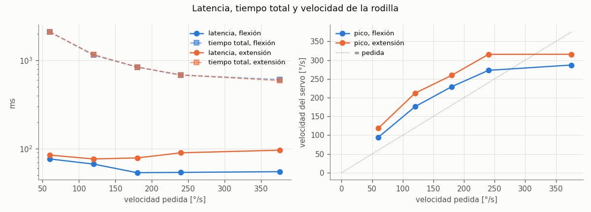

# 08 · Flexión y extensión completas de la rodilla, cada vez más rápido

| | |
|---|---|
| Fecha | 9 de noviembre de 2026 (corrida buena a las 18:27, el tercer intento) |
| Perro | Armado, en el soporte, con las patas al aire. Se mueve solo la rodilla de una pata (FL) |
| Firmware | `esp32_principal` del 9 de noviembre (el `S` rápido, nota 07). La prueba usa `G`, que ya existía |
| Script | [`pc/flexion.py`](../../pc/flexion.py) (`--simulado`, `--revisar`, `--reanalizar`) |
| Datos | [`datos/2026-11-09_flexion_fl/`](../../datos/2026-11-09_flexion_fl/) |
| Resultado | **La rodilla dobla y estira 121° en ~0.45 s (0.6 s hasta quedar quieta), a ~270 °/s; ahí se satura. Latencia del servo: ~55 ms al doblar** (al estirar se mide 76–96 ms, inflada por un salto de la lectura) |

## Por qué

Lo pidió el profe después de la primera prueba con las 4 patas (nota 07), que se veía lenta (a
propósito: 15–20 °/s):

> "Dile que haga flexión total, que extienda la patita completa y que lo haga rápido. Mide la
> latencia entre que le das la instrucción y la ejecuta."

La prueba 04 midió el servo **solo** (sin pata): ~100 ms de atraso y sin saturarse hasta 240 °/s.
Ahora el servo carga la espinilla y el pie, así que hay inercia. Aquí se mide qué tan rápido puede
doblar y estirar la rodilla de verdad, y cuánto tarda en responder.

## Montaje

- El perro en el soporte, las patas colgando. Solo la FL se mueve; las otras 3 quedan sueltas.
- Abducción y cadera de la FL quietas: pata vertical vista de frente, muslo vertical
  (`--cadera 0`). Así, estirada, el pie queda abajo (z ≈ 24 cm) y doblada queda adelante, a la
  altura de la cadera (x ≈ +10 cm, z ≈ 3 cm), lejos del cuerpo y de la RL.
- Fuente de 6 V. Anota su voltaje con `--voltaje`.

## Método

La rodilla va de **5° a 126° de flexión** y regresa:
- los límites de `pata.py` (5° antes de donde choca y 2° antes de recta);
- y 3° más adentro en cada lado (`--margen`), porque rápido se puede pasar un poco.

Las velocidades van de menor a mayor: **60, 120, 180, 240 °/s y la máxima del firmware** (`G` a
4000 µs/s, ~376 °/s, más de lo que da el servo sin carga). En cada una hace 2 flexiones y 2
extensiones, con 0.6 s quieta en cada extremo.

Igual que en la prueba 04, la rampa la hace la ESP32 (comando `G`): el pulso cambia cada 20 ms y
el cable verde se graba cada ~2 ms con el reloj de la placa. Por eso **la latencia que se mide es
la del servo con la pata, sin el USB ni Windows de por medio.** La de toda la cadena (botón del
panel → servo) ya se midió en la nota 07: ~0.25 s.

### Qué se calcula, en cada flexión y cada extensión

| Medida | Cómo |
|---|---|
| **Latencia** | Desde que el pulso pedido se movió 2° hasta que el cable verde se movió 2° (el ruido es ~0.3°) |
| Atraso en la rampa | Pedido − medido en la segunda mitad de la rampa, entre la velocidad (como la 04) |
| Velocidad real | Pendiente del medido en ese mismo tramo |
| Velocidad pico | La más alta del medido (derivada con 22 ms de suavizado) |
| Sobrepaso | Cuánto se pasa del valor final al llegar |
| Asentamiento | Desde que el pedido llega hasta que el medido queda a ±1° |
| **Tiempo total** | Desde el primer pulso nuevo hasta que la rodilla queda quieta (±1°) en el otro extremo |
| Error final | Valor final − pedido |

### Seguridad

- **Antes de empezar,** con los servos sueltos, dobla y estira la rodilla con la mano por todo el
  recorrido y revisa que el pie no le pegue a nada.
- **La pata tiene que estar adentro de sus límites para empezar.** Si no (por ejemplo, la rodilla
  colgando recta), no se mueve nada.
- **Primero va despacio (40 °/s) a la pose de inicio.** Luego las velocidades van de menor a mayor.
- **Después de cada velocidad revisa que la rodilla haya llegado a los dos extremos** (±6°). Si no
  llegó (¿choca?, ¿le falta fuerza?), se detiene y suelta.
- **Ctrl+C detiene todo:** cualquier byte por USB para la rampa en la placa, y el script suelta los
  servos.

## Cómo correrla

```
python pc\flexion.py --simulado                       # practicar sin el perro
python pc\flexion.py --port COM6 --revisar            # dónde está la pata y el plan; no mueve nada
python pc\flexion.py --port COM6 --voltaje 6.0        # la prueba, ~1 min
```

Si quieres ir con más calma la primera vez: `--velocidades 60 120` y luego la completa.

Salen en `pc/resultados_flexion/AAAAMMDD_HHMMSS/`:
- `resumen.md` (la tabla);
- `trazas.png` (pedido contra medido, en grados de flexión);
- `flexion.png` (latencia, tiempo total y velocidad contra la velocidad pedida);
- los CSV (`muestras`, `comandos`, `corridas`, `metricas`).

Esa carpeta se copia a `datos/AAAA-MM-DD_flexion/`.

## Resultados en simulación

El simulador es el de la prueba 04 (un control proporcional, **sin** el tiempo muerto del servo
real). Solo sirve para revisar el script: las latencias de verdad serán más altas (~100 ms en la
04).

| Pedida | Movimiento | Latencia | Tiempo total | Vel. pico | Sobrepaso | Error final |
|---|---|---|---|---|---|---|
| 60 °/s | flexión | 30 ms | 2022 ms | 95 °/s | 0.2° | 0.5° |
| 240 °/s | flexión | 19 ms | 559 ms | 258 °/s | 0.2° | 0.4° |
| máx. 376 °/s | flexión | 12 ms | 435 ms | 335 °/s | 0.1° | 0.5° |

Con el arnés del firmware (`G` de verdad por un pseudo-terminal) los datos llegan completos, y la
revisión "no llegó al extremo" sí detiene la prueba.

## Resultados con el perro

**Primer intento (9 nov, 17:54): se detuvo después de 60 °/s.** Dos problemas, ninguno del servo:

1. `datos de la rampa incompletos: 5984/5985 M, 599/599 C, 0 líneas dañadas`. De 6584 líneas, una
   no llegó bien por el USB (probablemente se le dañó la primera letra y el lector la ignoró). La
   prueba exigía las 6584 exactas. Ahora acepta perder hasta 1 % de las muestras o de los
   comandos (`TOLERANCIA`): una muestra de 2 ms que falta no cambia la latencia ni la velocidad.
   Lo que se pierde queda anotado en `corridas.csv` (`lineas_perdidas`) y se avisa. Si se pierde
   más, algo anda mal y se detiene igual. Al detenerse sin ninguna velocidad completa, el
   análisis ya no truena: dice que no hay nada que analizar.
2. **La pata usó límites viejos.** El plan dijo "doblada 139.6° de flexión (9.2° del servo)",
   pero el límite medido de la rodilla FL es 15° (el json del 9 nov, 16:58). Esa compu tenía el
   `pata_fl.json` de antes (rodilla 1.2–174.6°): la rodilla se mandó ~6° más allá de donde choca.
   Ahora el plan imprime los límites que leyó del json, para revisarlos antes de dar Enter. Con
   los límites buenos, la rodilla va de 5.0° a 125.8° de flexión (de 143.8° a 23.0° del servo).

**Segundo intento (9 nov, 18:12, firmware con `DIAG=1`): `la rampa del canal 2 no terminó a
tiempo`.** La ESP32 contestó `OK G` (empezó la rampa de 60 °/s, ~10.5 s), pero en los 15.5 s
siguientes el lector nunca vio `G DATOS`. Puede ser una de tres cosas, y el mensaje viejo no
decía cuál:

1. La ESP32 se reinició a media rampa y su línea de arranque llegó con basura adelante (el lector
   solo buscaba líneas que *empezaran* con `OK1-RETRO`).
2. La ESP32 se colgó y no mandó nada.
3. Sí mandó los datos, pero el encabezado `G DATOS` se perdió en el USB (como la línea perdida del
   primer intento), y el lector ignoró todas las `M` esperándolo.

Con el arnés (el firmware de verdad por un pseudo-terminal) `G` termina y los datos llegan, así que
el firmware nuevo no rompió `G`. Para que la próxima falla diga cuál fue:
- El lector reconoce un reinicio aunque la línea traiga basura, o por los mensajes del arranque
  (`rst:0x...`, `Brownout detector was triggered`).
- Si llegan datos sin su encabezado, los junta igual: los comandos se cuentan contra lo que dura
  la rampa (uno cada 20 ms) y las muestras por los huecos en el tiempo. Con la tolerancia de 1 %.
- Si no termina, dice si no llegó nada (la ESP32 callada) o qué líneas llegaron.
- Después de una falla, la prueba pregunta `?`: si `SEG` es menor que lo que lleva la prueba, la
  ESP32 se reinició (y `RESET` dice por qué); si no, muestra lo que contó el firmware durante la
  prueba (fallas de I²C, la escritura más lenta, la vuelta más larga). Queda en `meta.json`.
- "Servos sueltos" solo se dice si la ESP32 contestó `OK D`; si no, pide desconectar la fuente.

Después se le preguntó `?` a la ESP32: `RESET=encendido`, `SEG=588` (arrancó al abrir el puerto, a
las 18:12, y no otra vez), `I2CERR=0` e `I2CMAX=707` (la escritura de I²C más lenta de toda la
prueba: 0.7 ms). No se reinició, no se colgó y el I²C nunca falló: **lo más probable es la opción 3**,
el encabezado dañado en el USB. Y un dato aparte: `VUELTAMAX=189506`, una vuelta de `loop()` de
190 ms sin ningún comando (lo normal es 0.2 ms). No se sabe todavía de qué es; ver la nota 07.

### La corrida buena (9 nov, 18:27)

Rodilla FL de 5.0° a 125.8° de flexión (121°), cadera a 0°, fuente de 6.0 V, 2 vueltas por
velocidad. Las 5 velocidades completas, **ninguna línea perdida** en el USB, y la ESP32 contestó
`OK D` al final.

| Pedida (°/s) | Movimiento | Latencia (ms) | Atraso en la rampa (ms) | Vel. real (°/s) | Vel. pico (°/s) | Sobrepaso (°) | Tiempo total (ms) | Error final (°) |
|---|---|---|---|---|---|---|---|---|
| 60 | flexión | 76 | 105 | 61 | 94 | 0.2 | 2113 | 0.7 |
| 60 | extensión | 84 | 86 | 60 | 118 | 0.3 | 2101 | 0.9 |
| 120 | flexión | 67 | 101 | 120 | 176 | 0.2 | 1149 | 0.5 |
| 120 | extensión | 76 | 97 | 120 | 212 | 0.3 | 1166 | 1.1 |
| 180 | flexión | 53 | 102 | 180 | 229 | 0.2 | 840 | 0.6 |
| 180 | extensión | 78 | 101 | 179 | 260 | 0.2 | 841 | 1.1 |
| 240 | flexión | 54 | 104 | 237 | 273 | 0.2 | 682 | 0.8 |
| 240 | extensión | 89 | 105 | 242 | 315 | 0.2 | 685 | 1.1 |
| máx. (376) | flexión | 55 | 135 | **265** | 287 | 0.2 | **605** | 0.9 |
| máx. (376) | extensión | 96 | 125 | **277** | 316 | 0.2 | **589** | 1.0 |





**Lo que sale:**

- **Velocidad máxima: ~270 °/s con la pata.** Hasta 240 °/s la rodilla sigue la rampa (velocidad
  real = pedida). Pidiendo 376 °/s solo llega a 265–277 °/s: ahí se satura el servo con la
  espinilla. Sin pata (prueba 04) no se saturaba hasta 240 °/s; la hoja de datos dice 300 °/s.
- **Flexión completa, rápido:** 121° en ~0.45 s de movimiento; **0.6 s** desde el primer pulso
  hasta que queda quieta a ±1°. Las poses de la nota 07 iban a 15–20 °/s a propósito: el mismo
  cambio, a esa velocidad, tardaría 6–8 s.
- **El atraso durante el movimiento es ~100 ms a todas las velocidades**, igual que en la prueba
  04 sin pata: la espinilla no lo cambia. La velocidad pico pasa de la pedida porque el servo
  arranca atrasado y alcanza.
- **Latencia (desde que el pulso pedido se movió 2° hasta que la rodilla se movió 2°): ~55 ms al
  doblar** a 180 °/s o más, y 67–76 ms a 60–120 °/s. Incluye hasta 20 ms del refresco del PWM.
- **Al empezar a estirar, la lectura primero sube** (hacia más flexión) y luego baja: 0.4° a 60
  °/s, ~2° a 180–240 °/s y 4–4.5° a la máxima. Al empezar a doblar no pasa (≤ 0.5°, el ruido). Por
  eso la latencia de la extensión sale más grande (76–96 ms): el umbral de 2° se cuenta desde antes
  del salto. **No se sabe todavía si la rodilla de verdad se mueve al revés** (holgura de los
  engranes, la inercia de la espinilla) **o si es la lectura** (la corriente del motor mueve la
  tierra del cable verde). Se ve en las trazas: el piquito arriba de cada meseta antes de bajar.
- **Sobrepaso 0.2–0.3°** y error final 0.5–1.1° (el sesgo de ~0.6° de la prueba 05).

## Pendientes

- [x] Cargar el firmware del 9 de noviembre y correr la prueba en la FL (18:27, al tercer intento).
- [x] Comparar la latencia y la velocidad máxima con la prueba 04 (servo sin pata): el mismo
      atraso de ~100 ms; con la pata se satura en ~270 °/s.
- [ ] El salto de la lectura al empezar a estirar: grabarlo en video junto con la traza (¿se mueve
      el pie hacia arriba?) o repetir con la cadera en otro ángulo.
- [ ] Si sale bien: la cadera (con un recorrido más chico) y las otras patas (`--pata fr`, etc.).
