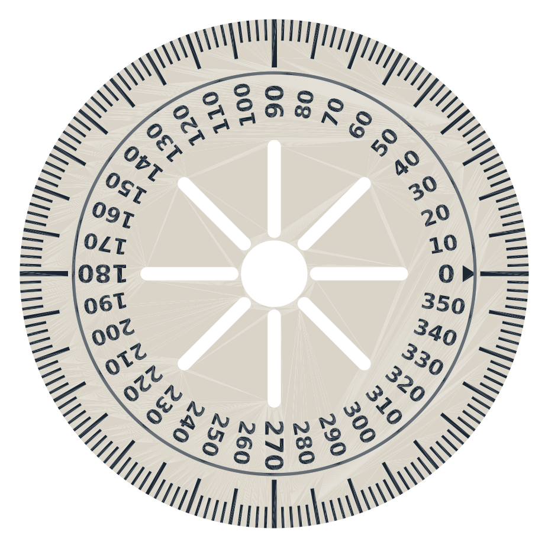

# Transportador para el servo FS5115M-FB

Sirve para comprobar que los grados que mandamos son los que gira el eje de verdad: 0°, 90°,
167.4° (el límite de 2360 µs) y los puntos intermedios. Se usa en la
[prueba 02](../../docs/bitacora/02_angulo_real.md).

## Las piezas

| Archivo | Qué es |
|---|---|
| `disco_transportador.stl` | Disco de Ø 84 × 2.6 mm. Tiene marcas cada 2°, más largas cada 10° y números cada 10°. Se atornilla **encima del horn** y gira con el eje |
| `indicador.stl` | Abrazadera que se mete por abajo del servo hasta topar con las orejas de montaje. Tiene una cuchilla vertical que queda a ~1 mm del borde del disco: es la marca fija contra la que se lee |
| `placa_transportador.stl` | Las dos piezas juntas en una sola cama (145 × 84 mm) |
| `transportador.py` | El generador. Para un disco más chico: `python transportador.py --radio 36` |

El disco gira con el eje, así que queda centrado aunque el indicador no esté perfecto. La
posición de la cuchilla solo mueve el cero, no la escala. Por eso el giro real es la
**diferencia** entre dos lecturas.

## Imprimir

- **Material y cama:** PLA, sin soportes, las dos piezas como salen (disco plano con las marcas
  hacia arriba; indicador parado sobre la abrazadera).
- **Capas:** 0.12–0.16 mm, para que salgan bien las marcas de 2° (0.45 mm de ancho, 1.47 mm entre
  una y otra en el borde). Con boquilla de 0.4 mm.
- **Contraste:** si tu impresora deja, cambia de filamento a los **2.0 mm** de altura (pausa o
  M600). Así las marcas y los números salen de otro color.
- **Indicador:** 4 paredes. La abrazadera es 0.15 mm más angosta que el servo, para que apriete.
  Si queda muy dura, lija un poco el interior; si queda floja, ponle un pedazo de cinta.

## Armar

1. **Indicador:** mételo por **abajo** del servo, con la abertura del lado del cable, y súbelo
   hasta que tope con las orejas. Queda con la cuchilla saliendo de un costado largo.
2. **Disco:** ponlo encima del horn y fíjalo con los tornillos chiquitos del horn, pasándolos por
   las ranuras hasta los agujeros del horn. También sirven M2 con tuerca, o cinta doble cara si
   queda firme.
3. **Al servo:** pon el horn con el disco en el eje y aprieta el tornillo del centro (M3 × 6),
   por el agujero de en medio del disco.
4. **Revisa que no roce:** gira el disco a mano, con el servo suelto. La cuchilla no debe tocar
   el borde. Si toca, aflójala o lija el filo.

## Leer

- **Desde dónde:** mira desde arriba, con el ojo encima de la cuchilla.
- **Cuál marca:** anota la que coincide con su filo. Entre dos marcas se puede estimar al grado
  (cada marca son 2°).
- **El cero no importa:** el estriado del eje (25 dientes) solo deja poner el horn cada 14.4°.
  Cuenta solo la diferencia entre lecturas.
- **Si los números bajan al girar:** resta al revés. Si pasa por el 0, súmale 360.

Medidas que se supusieron (Pololu: 40.8 × 20.1 × 39 mm):
- El eje está a ~10 mm del centro del cuerpo. Si está entre 8 y 12 mm, la cuchilla queda entre
  0.6 y 1.5 mm del borde del disco.
- De la cara de abajo de las orejas a la cara de arriba del disco hay ~17.5 mm. Por eso la
  cuchilla mide 26.5 mm desde la base de la abrazadera; si queda unos milímetros arriba o abajo
  del disco, igual se lee.
